# AI-READONLY: 家居裁缝辅料20款调研资料

调研日期：2026-10-17；上传日期：2026-10-20。这里的“新品”指选品参考方向，不代表2026年首次上市。资料为原调研快照，价格与供货状态未于上传日重新核实。

[下载完整图文资料包](20款家居裁缝辅料资料包.zip) · [离线交互参考册（下载后打开）](家居裁缝辅料20款参考册.html) · [结构化数据](商品调研数据.json)

包含20张对应参考图片。图片来自原商品页面，仅作选品研究并保留来源，不是自有商品图或可直接发布的素材。采购成本、实测包装重量、供应商尚未核实，均保留TBD。

## 总览

|序号|商品|规格及包装|用途|
|---|---|---|---|
|01|[窗帘褶皱带＋四爪钩套装](#item-01)|10m（标题11yd），白色；带宽待核实；褶皱带＋不锈钢四爪钩；标题50钩、五点30钩，数量冲突|把普通窗帘改成捏褶窗帘|
|02|[半透明S波浪窗帘带](#item-02)|带宽76mm，长10m；半透明；10m带；不包含轨道|纱帘、窗帘S形波浪褶皱|
|03|[短颈四爪窗帘褶皱钩](#item-03)|银色；名义长度3in≈76.2mm，实测待确认；10个褶皱钩＋4个端钩，共14件|多口袋窗帘带配套、横拉轨道窗帘|
|04|[可缝包布窗帘配重片](#item-04)|每片17g；包布约60×33mm；20片|窗帘下摆、桌布、旗帜增重垂坠|
|05|[罗马帘可缝塑料导绳环](#item-05)|名义1/2in≈12.7mm；透明；内外径口径待核实；24个|罗马帘、奥地利帘、气球帘导绳/固定|
|06|[可缝金属按扣带](#item-06)|长3yd≈2.743m；厂家系列带宽约20mm、扣距约25mm、扣径7.5mm；公母配对按扣带，具体展开长度按卖家确认|被套、枕套、靠垫、房车窗帘开合|
|07|[包边嵌绳芯](#item-07)|名义1/4in；页面并列6mm（约数），长20yd≈18.288m；白色；1卷绳芯，不含外包布|靠垫、沙发、床头软包、窗帘边缘滚条|
|08|[带绳芯成品包边滚条](#item-08)|名义总宽1/2in≈12.7mm，长55yd≈50.292m；白色；1卷成品滚条|靠垫、沙发布套、枕套、被套边缘|
|09|[双折斜裁包边带](#item-09)|成品名义宽1/2in≈12.7mm，长55yd≈50.292m；白色；1卷|被子、毯子、桌垫、靠垫边缘包边|
|10|[缝纫型子母粘扣带](#item-10)|宽1in≈25.4mm；白色；每卷12.6yd≈11.52m；钩面1卷＋毛面1卷；每卷12.6yd|可拆布套、软装搭扣、布艺收纳袋|
|11|[免缝熨烫卷边胶带](#item-11)|Regular Weight白色；3/8in≈9.5mm×10yd≈9.144m（型号3722）；1卷|轻薄窗帘、桌布等卷边改短|
|12|[连续尼龙拉链＋拉头](#item-12)|5号；米色；带总宽32mm、合拢链牙宽6.5mm；10yd≈9.144m；连续拉链10yd＋同色无锁拉头25个|沙发坐垫套、枕套、布艺收纳袋|
|13|[三角床单弹力固定带](#item-13)|白色三角款；可调；带宽及调节范围待核实；4组|床单、床垫保护套固定|
|14|[透明头螺旋布艺固定针](#item-14)|透明塑料头直径0.5in≈12.7mm；针长待核实；60个|床裙、沙发套、桌布、靠垫布固定|
|15|[软包曲线柔性金属收边齿条](#item-15)|长20ft≈6.096m；银色；1条卷装|沙发扶手、弧形椅背等隐形布边固定|
|16|[软包直线金属收边钉条](#item-16)|17in≈431.8mm长×0.5in≈12.7mm宽；针约3/4in≈19.05mm；5条|沙发椅背直线布边隐藏固定|
|17|[软包纸板收边条](#item-17)|宽1/2in≈12.7mm；长10yd≈9.144m；1卷|椅背、沙发布面直线折边、隐藏订钉|
|18|[家具弹力承托织带维修套装](#item-18)|带宽2in≈50.8mm；长60ft≈18.288m；黑色；织带60ft＋金属端夹60个＋说明书|座椅、沙发坐垫下方承托织带替换|
|19|[沙发底部防尘无纺布](#item-19)|36in×3yd≈0.914×2.743m；黑色；标称1.2oz/yd²；1片/段|沙发、椅子、弹簧床底部遮挡框架和订钉|
|20|[自粘帆布修补带](#item-20)|4×63in≈10.16×160.02cm；黑色；1卷|遮阳篷、帐篷、船罩、户外坐垫布面修补|

## 01 窗帘褶皱带＋四爪钩套装

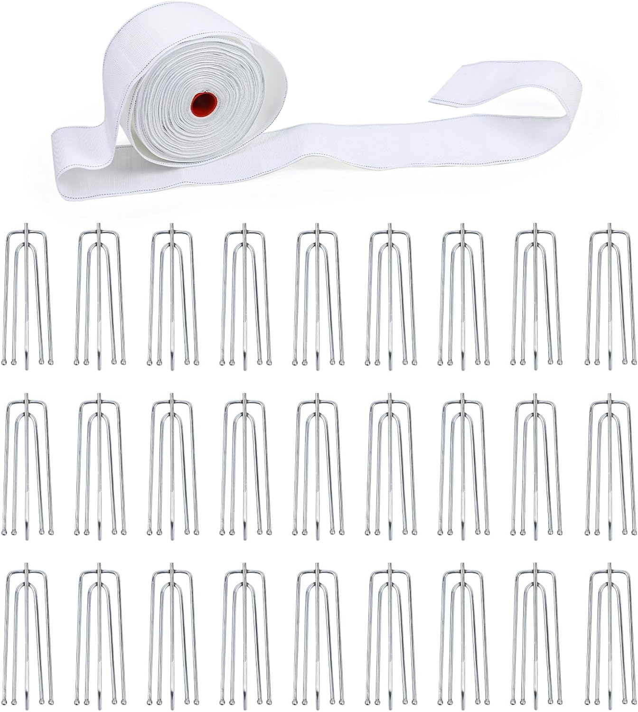

- **品牌**：UBCGOTT
- **分类**：窗帘制作
- **ASIN**：B0F1FVCJRJ
- **规格**：10m（标题11yd），白色；带宽待核实
- **包装**：褶皱带＋不锈钢四爪钩；标题50钩、五点30钩，数量冲突
- **材质**：钩为不锈钢；带材质待核实
- **用途**：把普通窗帘改成捏褶窗帘
- **采购搜索词**：窗帘四爪钩褶皱带套装 10米
- **选品判断**：先做褶皱带与钩配套小包装；确认带孔与钩距匹配
- **优先级**：优先
- **待确认和风险**：标题50个钩与五点30个钩矛盾，打样前必须确认
- **历史价格记录**：未显示可核实亚马逊售价
- **当前Amazon价格**：TBD
- **采购成本**：TBD
- **包装后重量**：TBD
- **供应商**：TBD
- **销量**：未核实，不据第三方估算填入
- **物流**：待按收货地址与所选SKU核实
- **商品来源**：[查看原商品](https://www.amazon.com/dp/B0F1FVCJRJ)
- **图片来源**：亚马逊目标ASIN页面landingImage；[原图地址](https://m.media-amazon.com/images/I/71hsxEBrMbL._AC_SL1500_.jpg)

## 02 半透明S波浪窗帘带

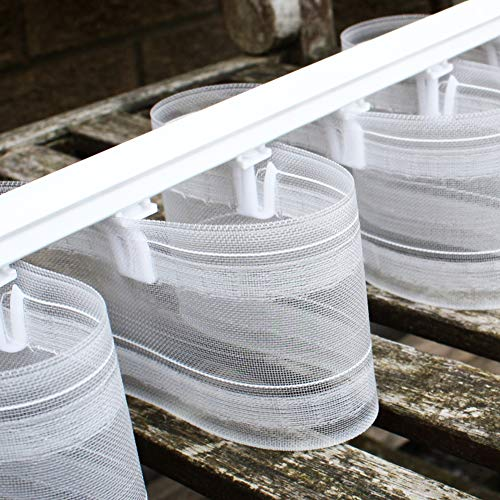

- **品牌**：Roomserve
- **分类**：窗帘制作
- **ASIN**：B07C8LLJND
- **规格**：带宽76mm，长10m；半透明
- **包装**：10m带；不包含轨道
- **材质**：100%聚酯
- **用途**：纱帘、窗帘S形波浪褶皱
- **采购搜索词**：76mm 半透明 S波浪窗帘带 60 80轨道
- **选品判断**：用途清楚，可与现有气眼产品形成窗帘辅料系列
- **优先级**：优先
- **待确认和风险**：仅适配预设滑轮间距的波浪轨道（常见60/80mm）；不可宣称通用
- **历史价格记录**：Amazon.ie旧快照€20.58；非实时价
- **当前Amazon价格**：TBD
- **采购成本**：TBD
- **包装后重量**：TBD
- **供应商**：TBD
- **销量**：未核实，不据第三方估算填入
- **物流**：待按收货地址与所选SKU核实
- **商品来源**：[查看原商品](https://www.amazon.ie/Roomserve-Translucent-Wave-Effect-Curtain-Heading/dp/B07C8LLJND)
- **图片来源**：FindTheDeal对应ASIN页面引用的亚马逊商品图；[原图地址](https://m.media-amazon.com/images/I/51Bgsx5ELLL._SL500_.jpg)

## 03 短颈四爪窗帘褶皱钩

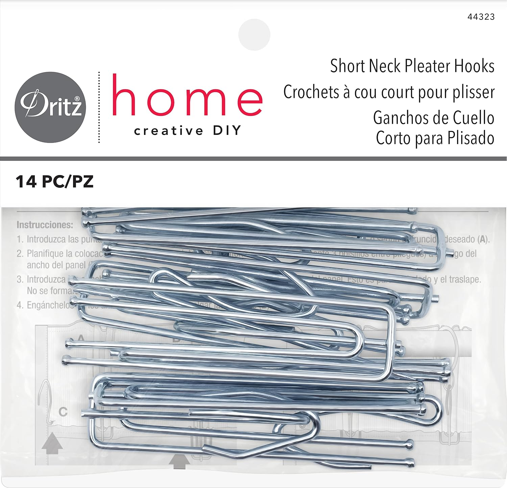

- **品牌**：Dritz Home
- **分类**：窗帘制作
- **ASIN**：B003W0Q6CG
- **规格**：银色；名义长度3in≈76.2mm，实测待确认
- **包装**：10个褶皱钩＋4个端钩，共14件
- **材质**：金属；具体合金待核实
- **用途**：多口袋窗帘带配套、横拉轨道窗帘
- **采购搜索词**：短颈四爪窗帘钩 端钩 多口袋窗帘带
- **选品判断**：五金类与现有商品接近，便于做配套套装
- **优先级**：优先
- **待确认和风险**：不能把14件全部写成四爪钩；钩距、钩长需匹配带子
- **历史价格记录**：未显示可核实亚马逊售价
- **当前Amazon价格**：TBD
- **采购成本**：TBD
- **包装后重量**：TBD
- **供应商**：TBD
- **销量**：未核实，不据第三方估算填入
- **物流**：待按收货地址与所选SKU核实
- **商品来源**：[查看原商品](https://www.amazon.com/dp/B003W0Q6CG)
- **图片来源**：亚马逊目标ASIN页面landingImage；[原图地址](https://m.media-amazon.com/images/I/81VwQhWuimL._AC_SL1500_.jpg)

## 04 可缝包布窗帘配重片

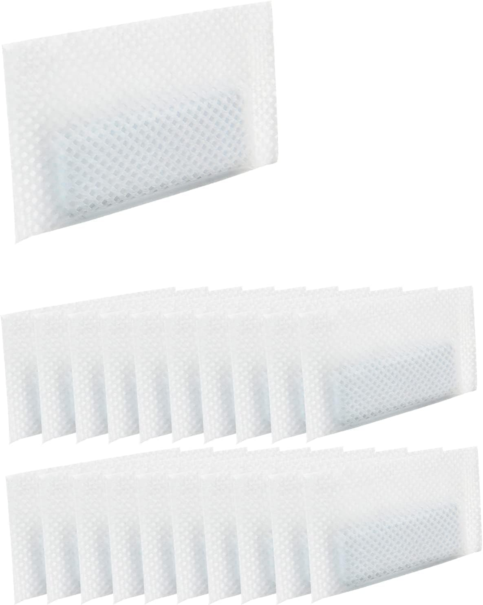

- **品牌**：Hitefu
- **分类**：窗帘制作
- **ASIN**：B097R7XB8D
- **规格**：每片17g；包布约60×33mm
- **包装**：20片
- **材质**：金属芯＋vinyl外包；标题写铁，描述出现lead，成分冲突
- **用途**：窗帘下摆、桌布、旗帜增重垂坠
- **采购搜索词**：窗帘包布配重片 17g 缝纫耳
- **选品判断**：可做片装补充包，重量与使用位置易展示
- **优先级**：后选
- **待确认和风险**：先核实金属成分，不能直接宣称无铅；重量影响运费
- **历史价格记录**：未显示可核实亚马逊售价
- **当前Amazon价格**：TBD
- **采购成本**：TBD
- **包装后重量**：TBD
- **供应商**：TBD
- **销量**：未核实，不据第三方估算填入
- **物流**：待按收货地址与所选SKU核实
- **商品来源**：[查看原商品](https://www.amazon.com/dp/B097R7XB8D)
- **图片来源**：亚马逊目标ASIN页面landingImage；[原图地址](https://m.media-amazon.com/images/I/51tIWgHbkxL._AC_SL1500_.jpg)

## 05 罗马帘可缝塑料导绳环

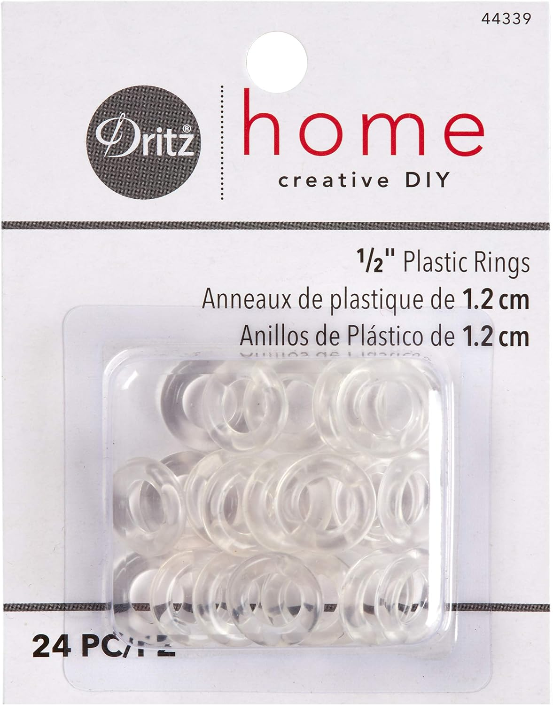

- **品牌**：Dritz Home
- **分类**：窗帘制作
- **ASIN**：B00DV8XTPQ
- **规格**：名义1/2in≈12.7mm；透明；内外径口径待核实
- **包装**：24个
- **材质**：塑料；具体树脂待核实
- **用途**：罗马帘、奥地利帘、气球帘导绳/固定
- **采购搜索词**：罗马帘 可缝 塑料导绳环 透明 12.7mm
- **选品判断**：小体积、可做维修替换包，与现有圆环商品区分用途
- **优先级**：备选
- **待确认和风险**：亚马逊五点误混订枪描述，使用厂家资料核对；不据此宣称承重
- **历史价格记录**：厂家系列页面$3.39，默认白色；透明款价格待核实
- **当前Amazon价格**：TBD
- **采购成本**：TBD
- **包装后重量**：TBD
- **供应商**：TBD
- **销量**：未核实，不据第三方估算填入
- **物流**：待按收货地址与所选SKU核实
- **商品来源**：[查看原商品](https://www.amazon.com/dp/B00DV8XTPQ)
- **补充来源**：[查看资料](https://prymamericas.com/collections/curtain-grommets-rings/products/dritzplasrngs12)
- **图片来源**：亚马逊目标ASIN页面landingImage；[原图地址](https://m.media-amazon.com/images/I/81H5mcimpML._AC_SL1500_.jpg)

## 06 可缝金属按扣带

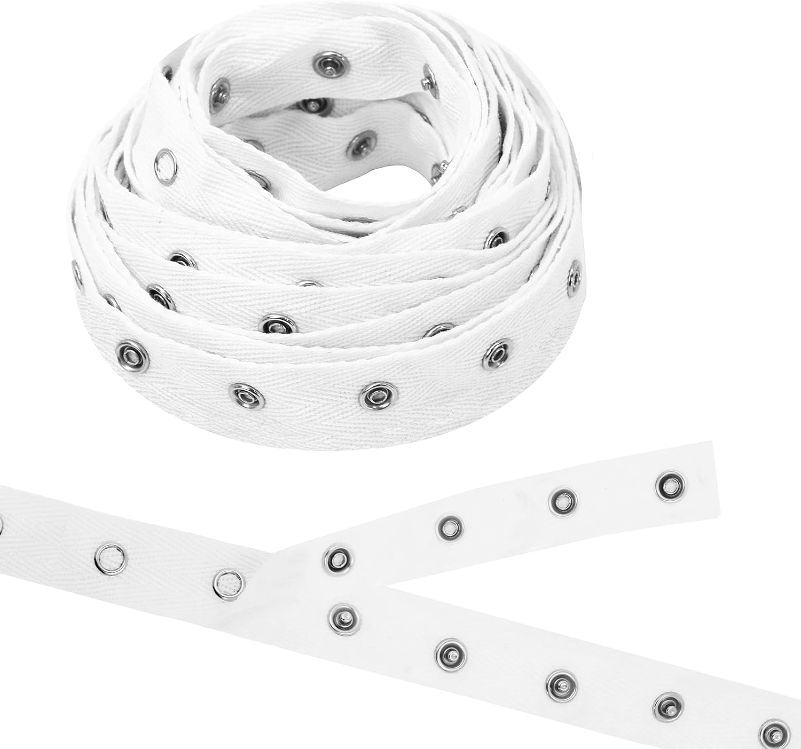

- **品牌**：Mandala Crafts
- **分类**：布艺连接
- **ASIN**：B09DTD991T
- **规格**：长3yd≈2.743m；厂家系列带宽约20mm、扣距约25mm、扣径7.5mm
- **包装**：公母配对按扣带，具体展开长度按卖家确认
- **材质**：棉斜纹带＋金属按扣
- **用途**：被套、枕套、靠垫、房车窗帘开合
- **采购搜索词**：棉质 金属按扣带 公母 2cm 1英寸间距
- **选品判断**：比散扣省定位步骤，适合家居缝纫买家
- **优先级**：优先
- **待确认和风险**：尺寸为厂家同系列描述；白色目标款需样品核对；洗前预缩和扣合力需测试
- **历史价格记录**：官网系列默认米色3yd示例$12.99；目标白色售价未核实
- **当前Amazon价格**：TBD
- **采购成本**：TBD
- **包装后重量**：TBD
- **供应商**：TBD
- **销量**：未核实，不据第三方估算填入
- **物流**：待按收货地址与所选SKU核实
- **商品来源**：[查看原商品](https://www.amazon.com/dp/B09DTD991T)
- **补充来源**：[查看资料](https://mandalacraftsinc.com/products/mandala-crafts-metal-snap-tape-for-sewing-by-yard-cotton-snap-button-trim-baby-snaps-for-sewing-fastener-button-strips-snap-tape-for-baby-clothes-3-yards-snap-tape)
- **图片来源**：亚马逊目标ASIN页面landingImage；[原图地址](https://m.media-amazon.com/images/I/71Eh8KnSzfL._AC_SL1500_.jpg)

## 07 包边嵌绳芯

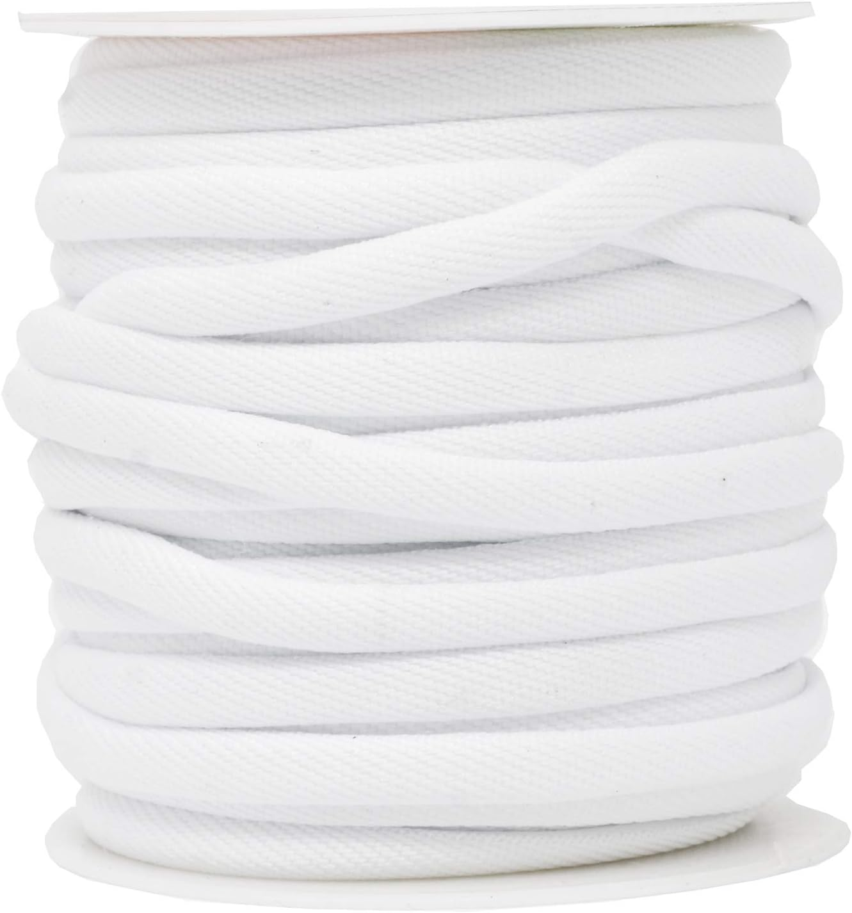

- **品牌**：Mandala Crafts
- **分类**：包边装饰
- **ASIN**：B07HQYMPB8
- **规格**：名义1/4in；页面并列6mm（约数），长20yd≈18.288m；白色
- **包装**：1卷绳芯，不含外包布
- **材质**：纤维素棉纤维芯＋聚酯包覆（按卖家描述）
- **用途**：靠垫、沙发、床头软包、窗帘边缘滚条
- **采购搜索词**：包边嵌绳芯 6mm 聚酯包覆 20码
- **选品判断**：可与成品包边带分开卖，规格和制作步骤容易展示
- **优先级**：优先
- **待确认和风险**：不是成品滚边条；1/4in与6mm是近似口径，采购需量实径
- **历史价格记录**：未显示可核实亚马逊售价
- **当前Amazon价格**：TBD
- **采购成本**：TBD
- **包装后重量**：TBD
- **供应商**：TBD
- **销量**：未核实，不据第三方估算填入
- **物流**：待按收货地址与所选SKU核实
- **商品来源**：[查看原商品](https://www.amazon.com/dp/B07HQYMPB8)
- **图片来源**：亚马逊目标ASIN页面landingImage；[原图地址](https://m.media-amazon.com/images/I/61-zueKHAaL._AC_SL1500_.jpg)

## 08 带绳芯成品包边滚条

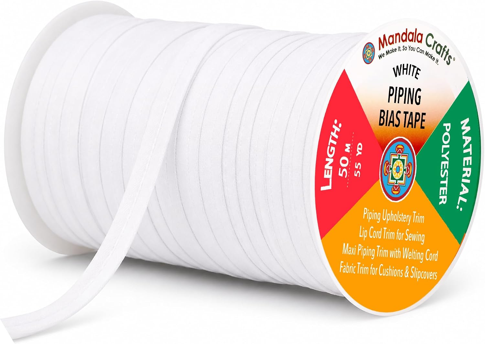

- **品牌**：Mandala Crafts
- **分类**：包边装饰
- **ASIN**：B07LDXZVN7
- **规格**：名义总宽1/2in≈12.7mm，长55yd≈50.292m；白色
- **包装**：1卷成品滚条
- **材质**：斜裁包边带＋棉绳芯；带面精确成分待核实
- **用途**：靠垫、沙发布套、枕套、被套边缘
- **采购搜索词**：家纺 成品带绳芯 嵌条 滚边 包边条 12mm
- **选品判断**：用户不必自己包绳，适合做颜色规格小卷
- **优先级**：优先
- **待确认和风险**：总宽不等于绳芯直径；需核对缝份和圆绳可见宽
- **历史价格记录**：未显示可核实亚马逊售价
- **当前Amazon价格**：TBD
- **采购成本**：TBD
- **包装后重量**：TBD
- **供应商**：TBD
- **销量**：未核实，不据第三方估算填入
- **物流**：待按收货地址与所选SKU核实
- **商品来源**：[查看原商品](https://www.amazon.com/dp/B07LDXZVN7)
- **图片来源**：亚马逊目标ASIN页面landingImage；[原图地址](https://m.media-amazon.com/images/I/71xUii0LfvL._AC_SL1500_.jpg)

## 09 双折斜裁包边带

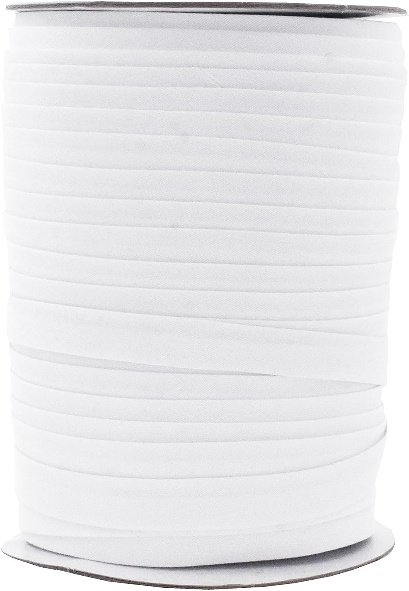

- **品牌**：Mandala Crafts
- **分类**：包边装饰
- **ASIN**：B08232CF5L
- **规格**：成品名义宽1/2in≈12.7mm，长55yd≈50.292m；白色
- **包装**：1卷
- **材质**：五点描述聚酯；属性混列棉/麻/聚酯，成分待样品确认
- **用途**：被子、毯子、桌垫、靠垫边缘包边
- **采购搜索词**：双折 斜裁包边带 12.7mm 家纺 55码
- **选品判断**：基础消耗辅料，可做多色和短卷供买家试用
- **优先级**：优先
- **待确认和风险**：页面长度属性1800in与标题55yd不一致；先确认实际长度和成分
- **历史价格记录**：Amazon页面快照一次购买$13.99，订阅$11.89；非实时价
- **当前Amazon价格**：TBD
- **采购成本**：TBD
- **包装后重量**：TBD
- **供应商**：TBD
- **销量**：未核实，不据第三方估算填入
- **物流**：待按收货地址与所选SKU核实
- **商品来源**：[查看原商品](https://www.amazon.com/dp/B08232CF5L)
- **补充来源**：[查看资料](https://mandalacraftsinc.com/products/mandala-crafts-double-fold-bias-tape-for-sewing-seaming-binding-hemming-piping-quilting)
- **图片来源**：亚马逊目标ASIN页面landingImage；[原图地址](https://m.media-amazon.com/images/I/715YIMkWQQL._AC_SL1500_.jpg)

## 10 缝纫型子母粘扣带

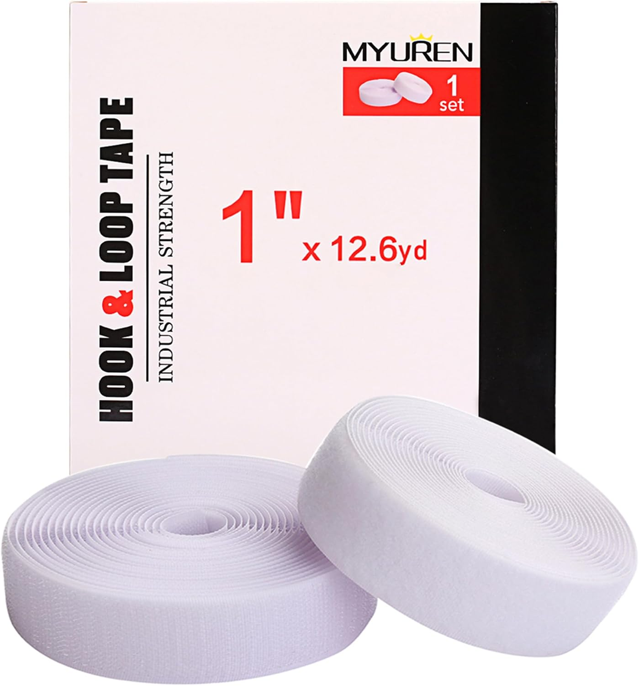

- **品牌**：MYUREN
- **分类**：布艺连接
- **ASIN**：B07PXJT25K
- **规格**：宽1in≈25.4mm；白色；每卷12.6yd≈11.52m
- **包装**：钩面1卷＋毛面1卷；每卷12.6yd
- **材质**：尼龙＋聚酯
- **用途**：可拆布套、软装搭扣、布艺收纳袋
- **采购搜索词**：缝纫型 无背胶 子母粘扣带 25mm
- **选品判断**：属于布艺连接基础品，能和按扣、拉链形成不同闭合方案
- **优先级**：优先
- **待确认和风险**：是无背胶缝纫款；不要把两卷总长误写成单面长度
- **历史价格记录**：未显示可核实亚马逊售价
- **当前Amazon价格**：TBD
- **采购成本**：TBD
- **包装后重量**：TBD
- **供应商**：TBD
- **销量**：未核实，不据第三方估算填入
- **物流**：待按收货地址与所选SKU核实
- **商品来源**：[查看原商品](https://www.amazon.com/dp/B07PXJT25K)
- **图片来源**：亚马逊目标ASIN页面landingImage；[原图地址](https://m.media-amazon.com/images/I/715VTNQiEXL._AC_SL1500_.jpg)

## 11 免缝熨烫卷边胶带

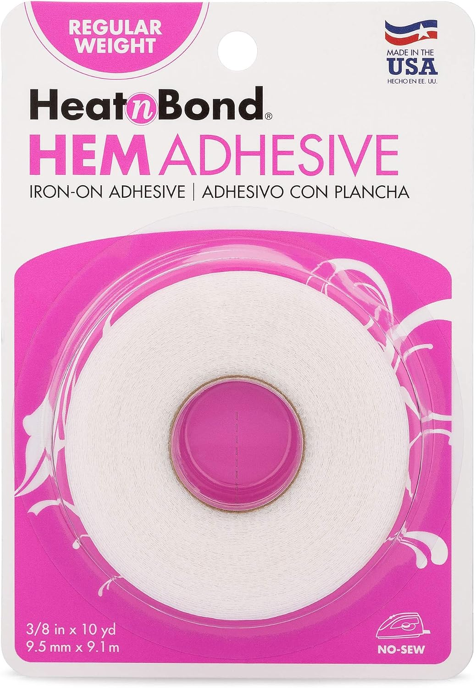

- **品牌**：HeatnBond
- **分类**：布艺修补
- **ASIN**：B000XZTSYQ
- **规格**：Regular Weight白色；3/8in≈9.5mm×10yd≈9.144m（型号3722）
- **包装**：1卷
- **材质**：热活化双面胶网；配方待核实
- **用途**：轻薄窗帘、桌布等卷边改短
- **采购搜索词**：免缝 熨烫 卷边胶带 胶网 9.5mm 10码
- **选品判断**：用途直观，适合做窗帘改短演示
- **优先级**：优先
- **待确认和风险**：普通重量版适配轻薄面料，不能直接当重磅帆布胶；需耐热/洗后测试
- **历史价格记录**：未显示可核实亚马逊售价
- **当前Amazon价格**：TBD
- **采购成本**：TBD
- **包装后重量**：TBD
- **供应商**：TBD
- **销量**：未核实，不据第三方估算填入
- **物流**：待按收货地址与所选SKU核实
- **商品来源**：[查看原商品](https://www.amazon.com/dp/B000XZTSYQ)
- **补充来源**：[查看资料](https://www.njeffersonltd.com/products/heatnbond-hem-regular-weight-iron-on-adhesive-tape)
- **图片来源**：亚马逊目标ASIN页面landingImage；[原图地址](https://m.media-amazon.com/images/I/81e0psHov4L._AC_SL1500_.jpg)

## 12 连续尼龙拉链＋拉头

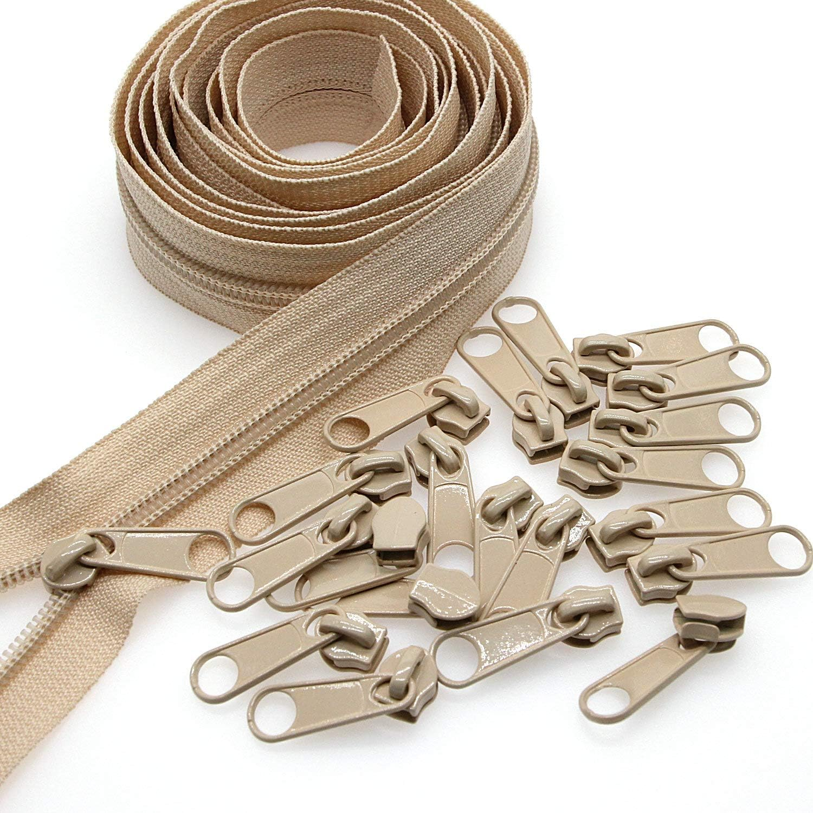

- **品牌**：Leekayer
- **分类**：布艺连接
- **ASIN**：B08HS3F9CB
- **规格**：5号；米色；带总宽32mm、合拢链牙宽6.5mm；10yd≈9.144m
- **包装**：连续拉链10yd＋同色无锁拉头25个
- **材质**：尼龙螺旋链牙；带面和拉头合金成分待核实
- **用途**：沙发坐垫套、枕套、布艺收纳袋
- **采购搜索词**：5号 尼龙 连续拉链 米色 10码 25拉头
- **选品判断**：长度可自行剪裁，家居布套维修用途明确
- **优先级**：优先
- **待确认和风险**：需自己装拉头和封端；不是可直接完全分离的开尾拉链
- **历史价格记录**：未显示可核实亚马逊售价
- **当前Amazon价格**：TBD
- **采购成本**：TBD
- **包装后重量**：TBD
- **供应商**：TBD
- **销量**：未核实，不据第三方估算填入
- **物流**：待按收货地址与所选SKU核实
- **商品来源**：[查看原商品](https://www.amazon.com/dp/B08HS3F9CB)
- **图片来源**：亚马逊目标ASIN页面landingImage；[原图地址](https://m.media-amazon.com/images/I/8178Ox3HZ0L._AC_SL1500_.jpg)

## 13 三角床单弹力固定带

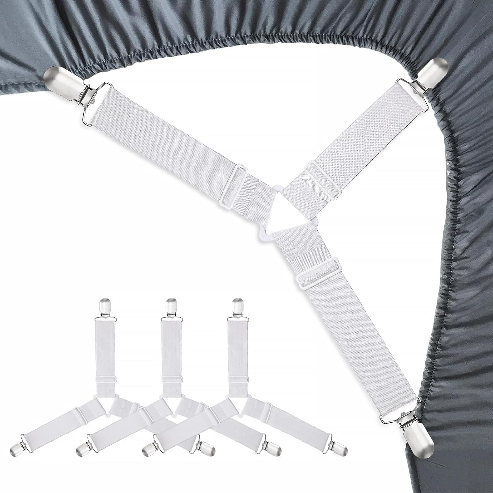

- **品牌**：RayTour
- **分类**：床品固定
- **ASIN**：B072XJTV7V
- **规格**：白色三角款；可调；带宽及调节范围待核实
- **包装**：4组
- **材质**：弹力带＋镀镍夹；纤维成分待核实
- **用途**：床单、床垫保护套固定
- **采购搜索词**：三角 床单固定带 弹力 金属夹 4组
- **选品判断**：由弹力织带与夹子组成，适合既有辅料供应链
- **优先级**：备选
- **待确认和风险**：需测试夹子咬合和面料损伤，不宣称适配所有床垫
- **历史价格记录**：未显示可核实亚马逊售价
- **当前Amazon价格**：TBD
- **采购成本**：TBD
- **包装后重量**：TBD
- **供应商**：TBD
- **销量**：未核实，不据第三方估算填入
- **物流**：待按收货地址与所选SKU核实
- **商品来源**：[查看原商品](https://www.amazon.com/dp/B072XJTV7V)
- **图片来源**：亚马逊目标ASIN页面landingImage；[原图地址](https://m.media-amazon.com/images/I/71mI6poUNCL._AC_SL1500_.jpg)

## 14 透明头螺旋布艺固定针

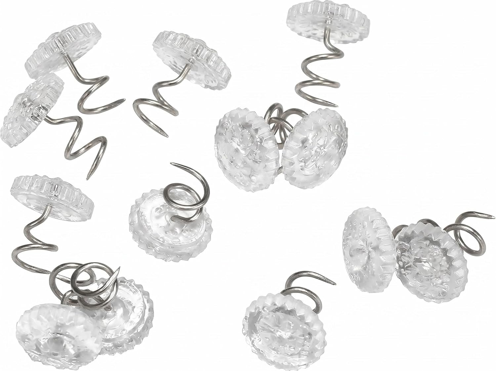

- **品牌**：Attmu
- **分类**：床品固定
- **ASIN**：B00Q87O00U
- **规格**：透明塑料头直径0.5in≈12.7mm；针长待核实
- **包装**：60个
- **材质**：塑料头＋金属螺旋针
- **用途**：床裙、沙发套、桌布、靠垫布固定
- **采购搜索词**：螺旋 布艺固定针 透明头 床裙 沙发套
- **选品判断**：小体积配件，安装前后效果容易拍清楚
- **优先级**：备选
- **待确认和风险**：尖针不可作儿童可接触床品配件；需测试是否刺穿底材和脱落
- **历史价格记录**：未显示可核实亚马逊售价
- **当前Amazon价格**：TBD
- **采购成本**：TBD
- **包装后重量**：TBD
- **供应商**：TBD
- **销量**：未核实，不据第三方估算填入
- **物流**：待按收货地址与所选SKU核实
- **商品来源**：[查看原商品](https://www.amazon.com/dp/B00Q87O00U)
- **图片来源**：亚马逊目标ASIN页面landingImage；[原图地址](https://m.media-amazon.com/images/I/717OYgGNMJL._AC_SL1500_.jpg)

## 15 软包曲线柔性金属收边齿条

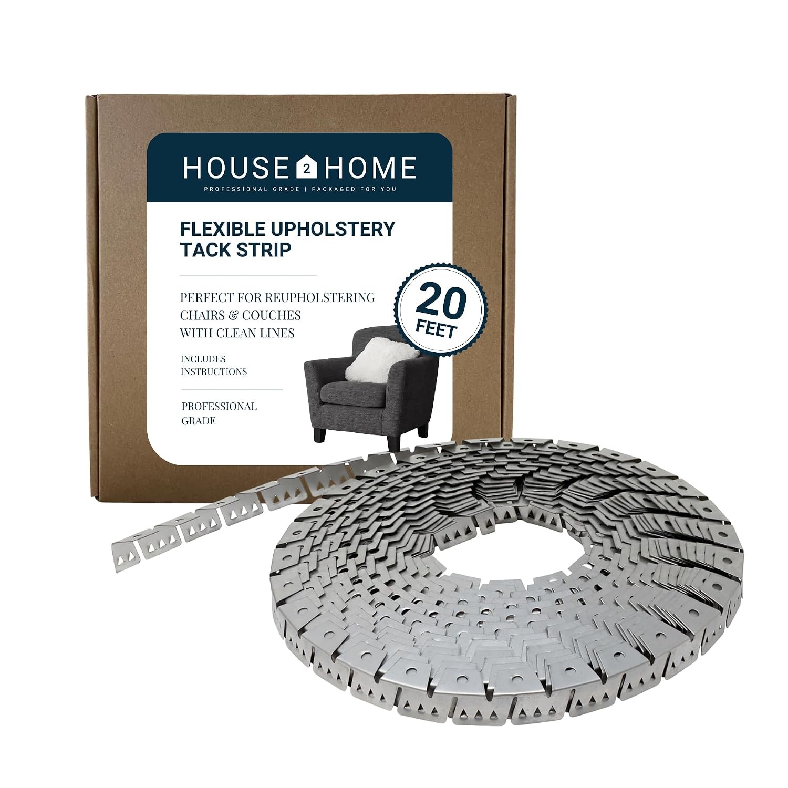

- **品牌**：House2Home
- **分类**：沙发翻新
- **ASIN**：B07SJZXCDZ
- **规格**：长20ft≈6.096m；银色
- **包装**：1条卷装
- **材质**：金属；镀层待核实
- **用途**：沙发扶手、弧形椅背等隐形布边固定
- **采购搜索词**：软包 曲线 三齿 金属收边条 ply grip
- **选品判断**：比普通装饰钉更偏维修细分，适合做安装说明图
- **优先级**：后选
- **待确认和风险**：有锋利齿口；需剪切工具、钉枪/安装工具；不能当受力框架件
- **历史价格记录**：品牌官网同款20ft页面$11.35；非亚马逊售价
- **当前Amazon价格**：TBD
- **采购成本**：TBD
- **包装后重量**：TBD
- **供应商**：TBD
- **销量**：未核实，不据第三方估算填入
- **物流**：待按收货地址与所选SKU核实
- **商品来源**：[查看原商品](https://www.amazon.com/dp/B07SJZXCDZ)
- **补充来源**：[查看资料](https://house2home-us.com/collections/all)
- **图片来源**：亚马逊目标ASIN页面landingImage；[原图地址](https://m.media-amazon.com/images/I/71Rjq8xj81L._SL1500_.jpg)

## 16 软包直线金属收边钉条

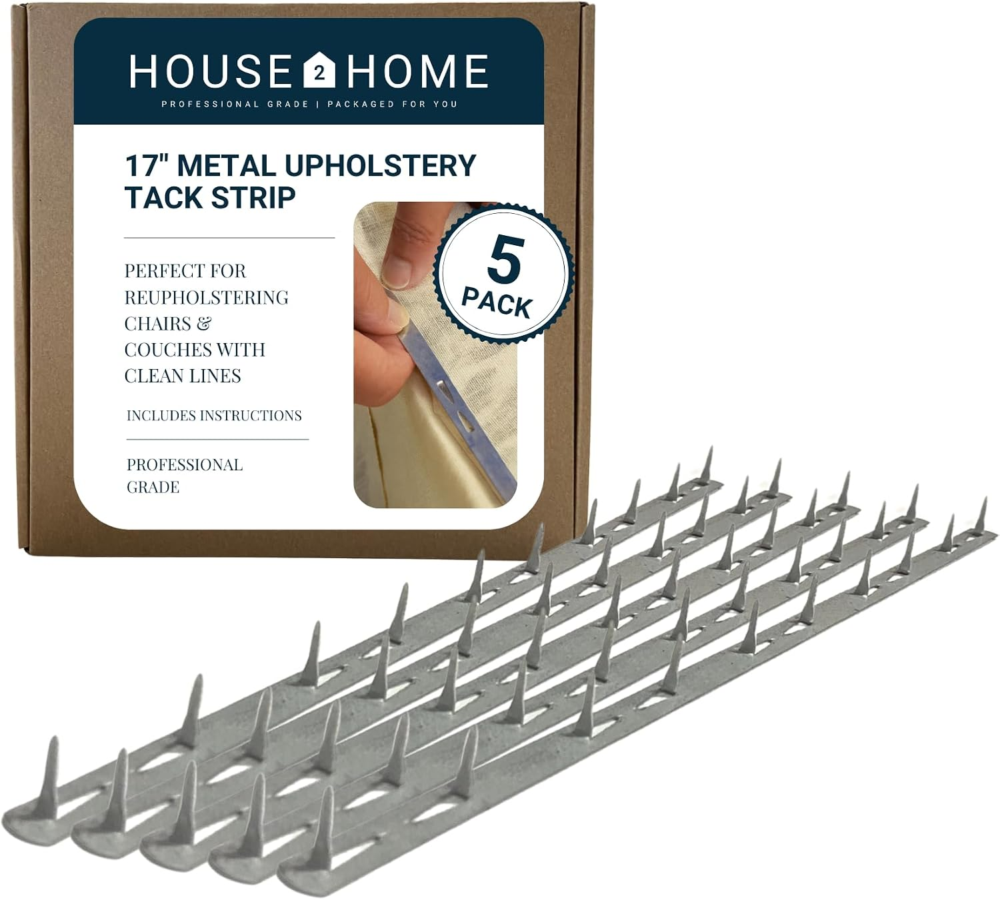

- **品牌**：House2Home
- **分类**：沙发翻新
- **ASIN**：B07VX7P366
- **规格**：17in≈431.8mm长×0.5in≈12.7mm宽；针约3/4in≈19.05mm
- **包装**：5条
- **材质**：金属；镀层待核实
- **用途**：沙发椅背直线布边隐藏固定
- **采购搜索词**：软包 直线 金属钉条 17英寸 5条
- **选品判断**：与曲线齿条用途不同，可作为翻新配件组合
- **优先级**：后选
- **待确认和风险**：长条体积和尖齿影响包装；需橡胶锤、剪铁工具
- **历史价格记录**：品牌官网17in/5条页面$12.49；非亚马逊售价
- **当前Amazon价格**：TBD
- **采购成本**：TBD
- **包装后重量**：TBD
- **供应商**：TBD
- **销量**：未核实，不据第三方估算填入
- **物流**：待按收货地址与所选SKU核实
- **商品来源**：[查看原商品](https://www.amazon.com/dp/B07VX7P366)
- **补充来源**：[查看资料](https://house2home-us.com/collections/all)
- **图片来源**：亚马逊目标ASIN页面landingImage；[原图地址](https://m.media-amazon.com/images/I/715wbHs579L._AC_SL1500_.jpg)

## 17 软包纸板收边条

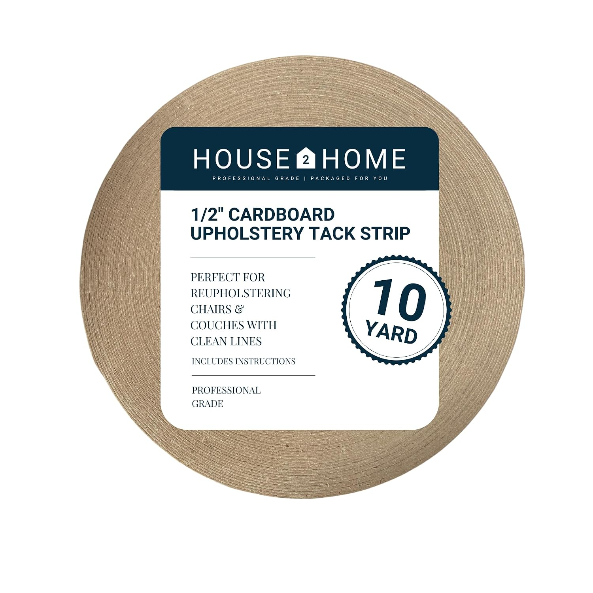

- **品牌**：House2Home
- **分类**：沙发翻新
- **ASIN**：B085HBBKK7
- **规格**：宽1/2in≈12.7mm；长10yd≈9.144m
- **包装**：1卷
- **材质**：纸板
- **用途**：椅背、沙发布面直线折边、隐藏订钉
- **采购搜索词**：软包 纸板收边条 12.7mm 10码
- **选品判断**：耗材型产品，卷装且易剪裁，适合家具翻新买家
- **优先级**：备选
- **待确认和风险**：不是双面胶或金属承力条；受潮环境适用性需测试
- **历史价格记录**：品牌官网10yd同款$8.96；非亚马逊售价
- **当前Amazon价格**：TBD
- **采购成本**：TBD
- **包装后重量**：TBD
- **供应商**：TBD
- **销量**：未核实，不据第三方估算填入
- **物流**：待按收货地址与所选SKU核实
- **商品来源**：[查看原商品](https://www.amazon.com/dp/B085HBBKK7)
- **补充来源**：[查看资料](https://house2home-us.com/collections/all?page=2)
- **图片来源**：亚马逊目标ASIN页面landingImage；[原图地址](https://m.media-amazon.com/images/I/717TnkuF88L._SL1500_.jpg)

## 18 家具弹力承托织带维修套装

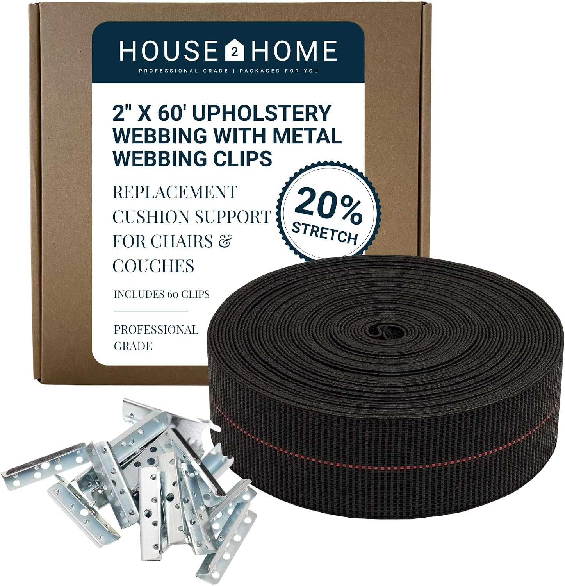

- **品牌**：House2Home
- **分类**：沙发翻新
- **ASIN**：B081895Y9K
- **规格**：带宽2in≈50.8mm；长60ft≈18.288m；黑色
- **包装**：织带60ft＋金属端夹60个＋说明书
- **材质**：弹力织带＋金属端夹；纤维/弹性体成分待核实
- **用途**：座椅、沙发坐垫下方承托织带替换
- **采购搜索词**：沙发 椅子 弹力承托织带 50mm 金属端夹
- **选品判断**：织带＋五金配套方向，与现有业务衔接较好
- **优先级**：备选
- **待确认和风险**：承重、伸长率和框架兼容性需打样；不能照抄通用承重数值
- **历史价格记录**：品牌官网2in×60ft含夹套装$52.99；非亚马逊售价
- **当前Amazon价格**：TBD
- **采购成本**：TBD
- **包装后重量**：TBD
- **供应商**：TBD
- **销量**：未核实，不据第三方估算填入
- **物流**：待按收货地址与所选SKU核实
- **商品来源**：[查看原商品](https://www.amazon.com/dp/B081895Y9K)
- **补充来源**：[查看资料](https://house2home-us.com/collections/all?page=2)
- **图片来源**：亚马逊目标ASIN页面landingImage；[原图地址](https://m.media-amazon.com/images/I/81ghL8PN5mL._AC_SL1500_.jpg)

## 19 沙发底部防尘无纺布

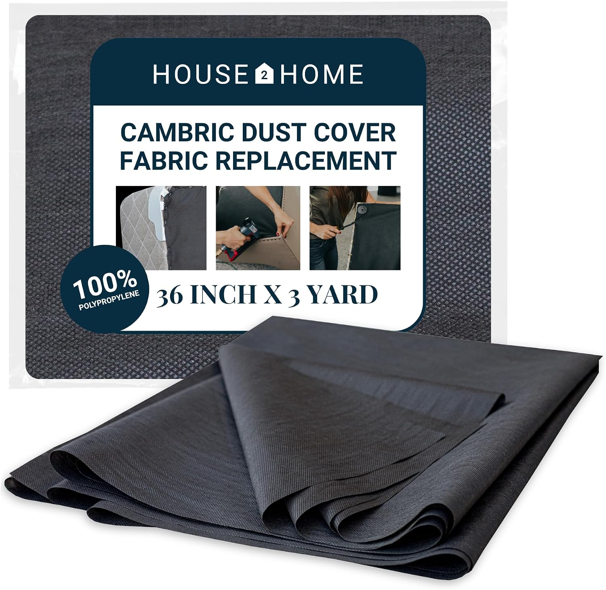

- **品牌**：House2Home
- **分类**：沙发翻新
- **ASIN**：B084P8C3BK
- **规格**：36in×3yd≈0.914×2.743m；黑色；标称1.2oz/yd²
- **包装**：1片/段
- **材质**：100%聚丙烯无纺布
- **用途**：沙发、椅子、弹簧床底部遮挡框架和订钉
- **采购搜索词**：沙发底布 黑色 PP无纺布 36英寸 3码
- **选品判断**：明确维修用途，可按小面积分切销售
- **优先级**：后选
- **待确认和风险**：底部防尘布，不是沙发表面坐垫布，不宣称防水
- **历史价格记录**：品牌官网36in×3yd同款$10.91；非亚马逊售价
- **当前Amazon价格**：TBD
- **采购成本**：TBD
- **包装后重量**：TBD
- **供应商**：TBD
- **销量**：未核实，不据第三方估算填入
- **物流**：待按收货地址与所选SKU核实
- **商品来源**：[查看原商品](https://www.amazon.com/dp/B084P8C3BK)
- **补充来源**：[查看资料](https://house2home-us.com/collections/all?page=2)
- **图片来源**：亚马逊目标ASIN页面landingImage；[原图地址](https://m.media-amazon.com/images/I/8132grBZ6kL._AC_SL1500_.jpg)

## 20 自粘帆布修补带

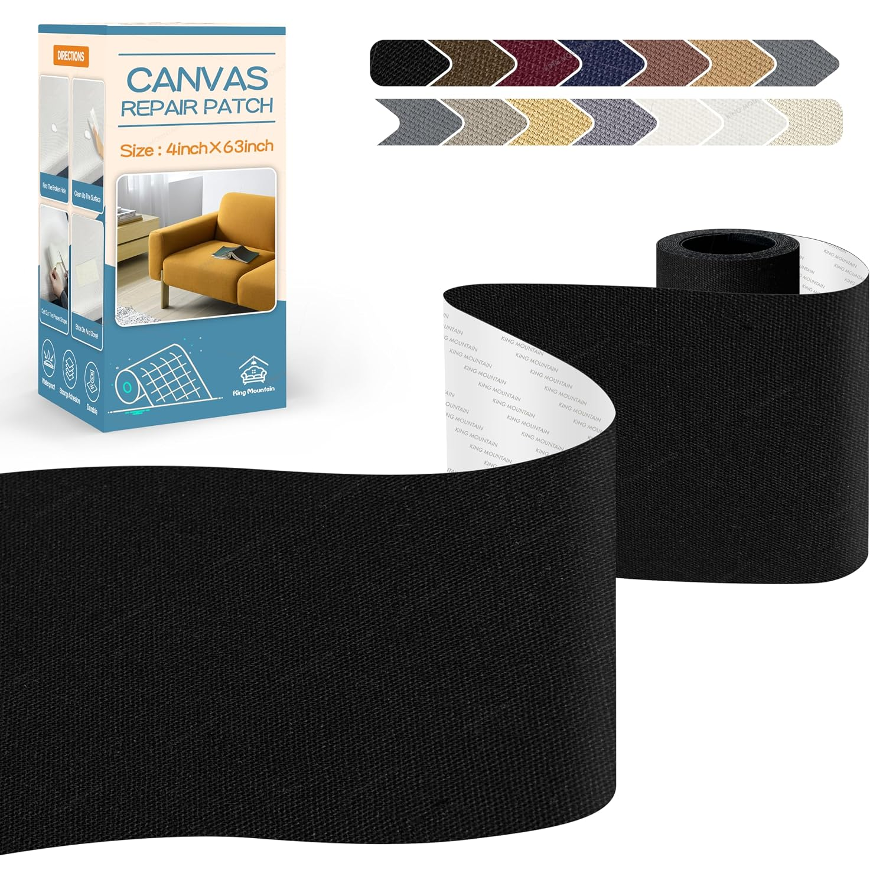

- **品牌**：KING MOUNTAIN
- **分类**：布艺修补
- **ASIN**：B0CB7RFJX8
- **规格**：4×63in≈10.16×160.02cm；黑色
- **包装**：1卷
- **材质**：帆布类贴片＋背胶；精确纤维/胶种待核实
- **用途**：遮阳篷、帐篷、船罩、户外坐垫布面修补
- **采购搜索词**：户外 帆布 修补贴 自粘 10cm 1.6m
- **选品判断**：可与现有大型气眼做防雨布维修场景配套
- **优先级**：优先
- **待确认和风险**：页面防水属于卖家主张，需验证面料相容、日晒、雨淋和残胶；不承诺修补后水密
- **历史价格记录**：未显示可核实亚马逊售价
- **当前Amazon价格**：TBD
- **采购成本**：TBD
- **包装后重量**：TBD
- **供应商**：TBD
- **销量**：未核实，不据第三方估算填入
- **物流**：待按收货地址与所选SKU核实
- **商品来源**：[查看原商品](https://www.amazon.com/dp/B0CB7RFJX8)
- **图片来源**：亚马逊目标ASIN页面landingImage；[原图地址](https://m.media-amazon.com/images/I/91MCTxKXOHL._SL1500_.jpg)
